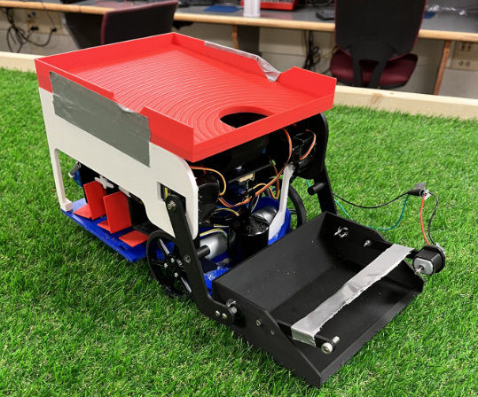
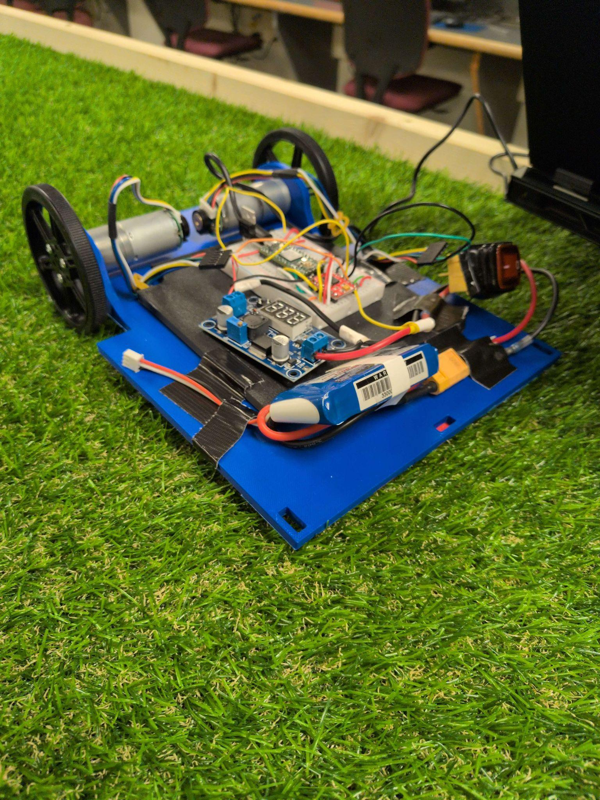
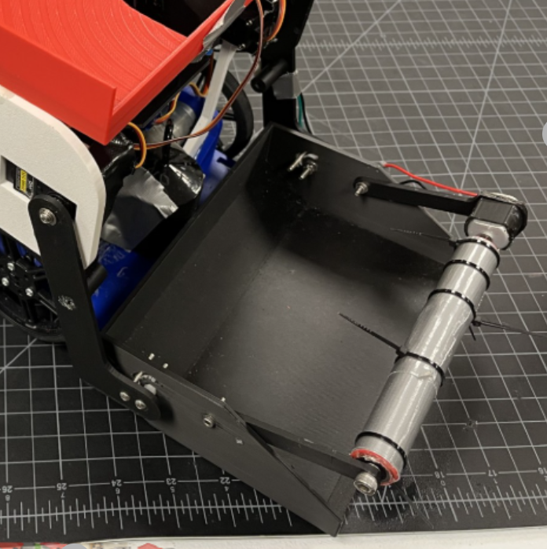
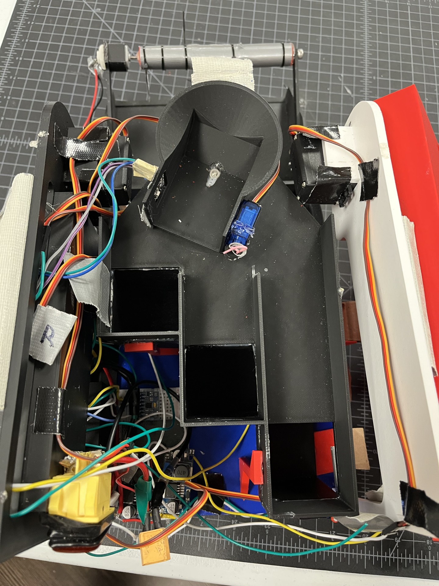
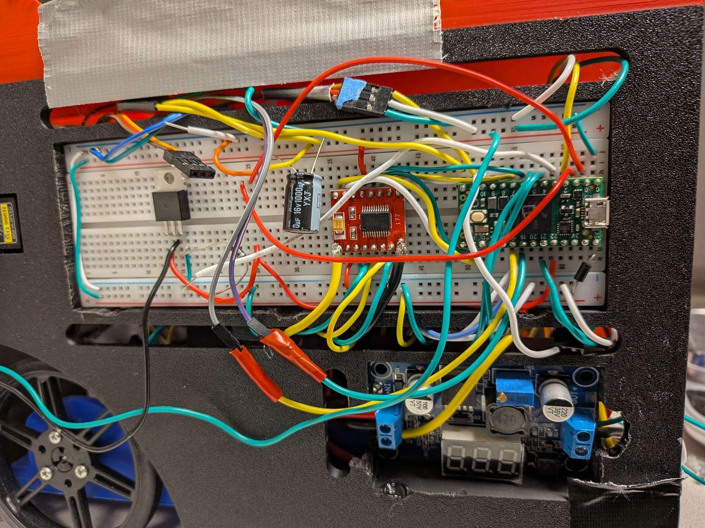

# Golf Ball Color Sorting Robot

Course project for Monroe Community College's ENR 259 engineering class. The Teensy 4.0 robot identifies red, white, and blue golf balls, follows a multi-stage route, and sorts and drops each ball using a conveyor, scoop, and servo gates.

The completed robot photo is from the MCC ENR 259 team presentation and shows the robot without team members.

## MCC Build Photos

Presentation photos show the robot prototype, roller intake, internal mechanism, and controller wiring.

| Prototype | Roller Intake |
| --- | --- |
|  |  |

| Internal Mechanism | Controller And Power Wiring |
| --- | --- |
|  |  |

## System Overview

- A TCS34725 color sensor classifies each ball while a Teensy 4.0 coordinates the mission state machine.
- An MPU-6050 supplies heading data for drive correction. A TB6612FNG controls the drive motors.
- The conveyor, scooper, sorter, and final drop gates run as separate modules so the mission logic can sequence them independently.
- Two limit switches provide final alignment inputs before the drop sequence.

## Hardware And Pin Map

| Signal | Teensy 4.0 Pin |
| --- | ---: |
| Motor driver PWMA / AIN1 / AIN2 | 14 / 16 / 15 |
| Motor driver PWMB / BIN1 / BIN2 | 8 / 6 / 7 |
| Motor driver standby | 9 |
| Left / right scooper servos | 4 / 5 |
| Sorting / sorting-gate servos | 3 / 2 |
| Red / white / blue final gates | 11 / 12 / 13 |
| Conveyor PWM | 22 |
| I2C SDA / SCL | 18 / 19 |
| First / rear limit switches | 23 / 24 |

The MPU-6050 and TCS34725 share the I2C bus. Each limit switch is wired between its pin and ground; the project notes specify INPUT_PULLUP. Encoders are disabled in this configuration because their pins are used by the sorter and scooper.

## Source Map

| File | Responsibility |
| --- | --- |
| ENR259_Robot_Project.ino | Startup and top-level application |
| Mission files | Route and mission sequencing |
| Drivebase files | Motor drive and heading correction |
| Sorting files | Color classification and sorting sequence |
| Conveyor, Scooper, and Gates files | Ball transport and actuators |
| LimitSwitches files | Final-position inputs |
| Logger files and Config.h | Diagnostics and tunable settings |

## Build And Tuning

Open the sketch in the Arduino environment with Teensy 4.0 board support and the libraries required by the included source. Generated IDE files and compiled outputs are not included. Confirm the pin map and servo direction for your build, calibrate the color sensor with the sensor area clear at startup, and tune the time-based final-drop movement on the actual course before a run.

This repository contains ENR 259 course hardware and control code. The wiring and timing have not been validated against every robot configuration.
