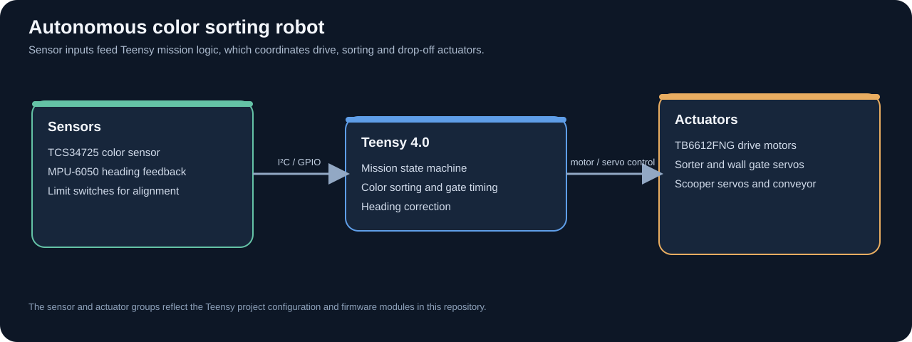

# Embedded Systems and Robotics Projects

Three hands-on projects spanning embedded firmware, sensor integration, autonomous navigation, and digital system control. Each project folder includes source and a short guide; the diagrams show how the code connects to the hardware.

## Autonomous Color Sorting Robot

Built around a Teensy 4.0, this C/C++ robot classifies red, white, and blue golf balls, follows a multi-lane mission, and coordinates its drivebase, conveyor, sorter, scooper, and final drop gates. Its firmware uses an MPU-6050 for heading correction, a TCS34725 for color sensing, and limit switches for final alignment.

[View the robot source and wiring notes](https://github.com/TylerM-Personal/ENR259_Robot_Project/tree/main/ENR259_Robot_Project)

## Smart Thermostat Fan

Bare-metal C and Assembly firmware for the TI MSPM0G3507 samples a thermistor and setpoint potentiometer, then controls fan duty cycle with 4 kHz software PWM. It reports temperature and mode on an LCD and shows fan duty on SPI displays, with an over-temperature buzzer and UART diagnostics. The project source credits Tyler Mulvehill and Hakan Demirtas.

[View the thermostat source](https://github.com/TylerM-Personal/ENR259_Robot_Project/tree/main/projects/smart-thermostat-fan)

## EV3 Hockey Puck Robot

The Pybricks program uses reflected-light and color readings to follow the course and recognize checkpoints. An ultrasonic sensor checks the goal distance before the arm motor runs a five-puck shooting sequence.

[View the EV3 source](https://github.com/TylerM-Personal/ENR259_Robot_Project/tree/main/projects/ev3-hockey-robot)

## Source map

| Project | Main technologies | Source |
| --- | --- | --- |
| Color sorting robot | C/C++, Teensy 4.0, I²C sensors, motor and servo control | [Project folder](https://github.com/TylerM-Personal/ENR259_Robot_Project/tree/main/ENR259_Robot_Project) |
| Smart thermostat fan | C, Assembly, TI MSPM0G3507, ADC, PWM, SPI, UART | [Project folder](https://github.com/TylerM-Personal/ENR259_Robot_Project/tree/main/projects/smart-thermostat-fan) |
| EV3 hockey robot | Python, Pybricks, line following, ultrasonic sensing | [Project folder](https://github.com/TylerM-Personal/ENR259_Robot_Project/tree/main/projects/ev3-hockey-robot) |

The thermostat and EV3 folders include source and setup notes; generated build outputs are omitted.
